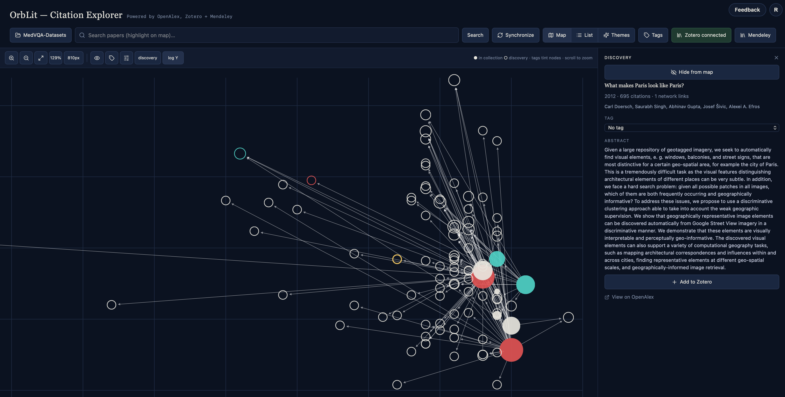
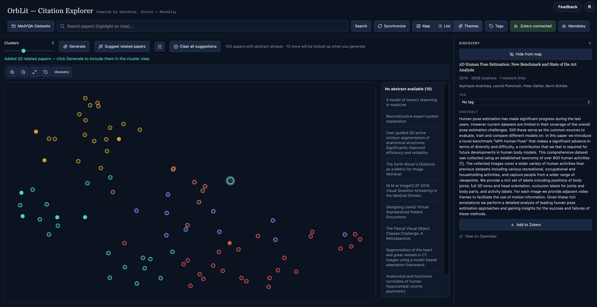
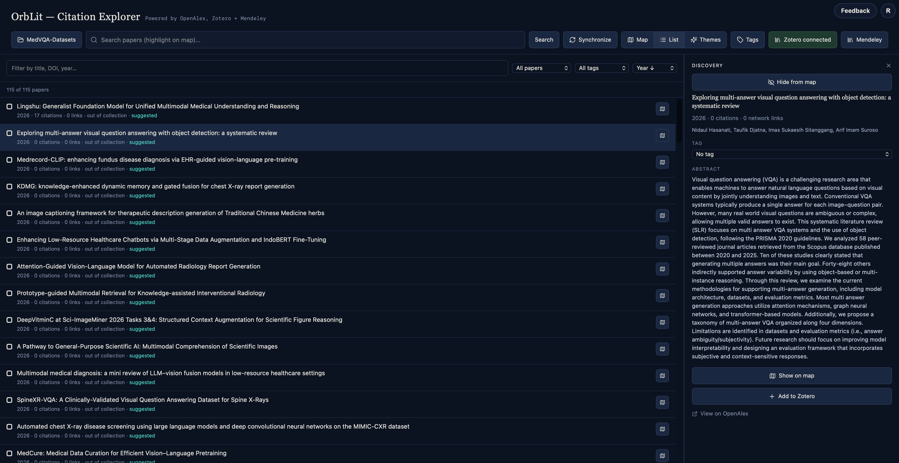

# OrbLit

OrbLit is a free, open-source citation map for the reference manager you already use. Connect [Zotero](https://www.zotero.org) or [Mendeley](https://www.mendeley.com), and OrbLit turns a collection into an interactive network: which papers cite each other, how they cluster by theme, and which related papers you have not saved yet. Search comes from [OpenAlex](https://openalex.org). Papers you find can be written back, PDF included.

Licensed under the [MIT License](LICENSE).

## Two ways to use it

### On the web

Open [orblit.io](https://orblit.io) and sign in with Google or GitHub. Nothing to install. Your maps and your Zotero or Mendeley connection are stored with that account.

### On your computer

Clone this repo and run it yourself. There is no account. Maps are saved as JSON files in `data/projects/` on your machine. This copy does not talk to orblit.io.

```bash
git clone https://github.com/Acul01/OrbLit
cd OrbLit
npm install
cp .env.example .env.local
```

In `.env.local` set `ORBLIT_MODE=local`. Optional Zotero keys, from [zotero.org/settings/keys](https://www.zotero.org/settings/keys):

```bash
ORBLIT_MODE=local
ZOTERO_USER_ID=
ZOTERO_API_KEY=
```

```bash
npm run dev
```

The app opens at `http://localhost:3000`. OpenAlex needs no key. For Mendeley, set `MENDELEY_CLIENT_ID` and `MENDELEY_CLIENT_SECRET` from an app whose redirect URL is `http://localhost:3000/api/mendeley/callback`. `OPENAI_API_KEY` and `SEMANTIC_SCHOLAR_API_KEY` are optional and only used for thematic clusters and abstract fallback.

## What you see

### Map



A collection plotted by publication year and citation count. Filled nodes are papers already in the library. Outlined nodes are related papers you have not saved yet, and the lines between them are citations. Click a node for the abstract, then add the paper to Zotero or Mendeley.

### Themes



The same papers grouped by what they are about, from title and abstract. Each color is one theme. Related papers can be suggested and then included in the clusters.

### List



Every paper from the map as a filterable list, by title, DOI, year, tag, or whether it is already in the collection. A row opens the same detail panel, and can be shown on the map or written back to the library.

## Stack

- **Next.js 16** (App Router)
- **Supabase** for accounts and saved maps on [orblit.io](https://orblit.io). A local run (`ORBLIT_MODE=local`) stores maps as JSON instead
- **next-intl** for English and German (`/de`)
- Zotero and Mendeley are called from the server. On orblit.io, keys and tokens are encrypted with AES-256-GCM and are not stored in the browser. A local run keeps them in `.env.local` and `data/` on that machine

The schema in `supabase/migrations/` is for the hosted app. A local run does not need it.

A production build of your own copy:

```bash
npm run build
npm run start
```
